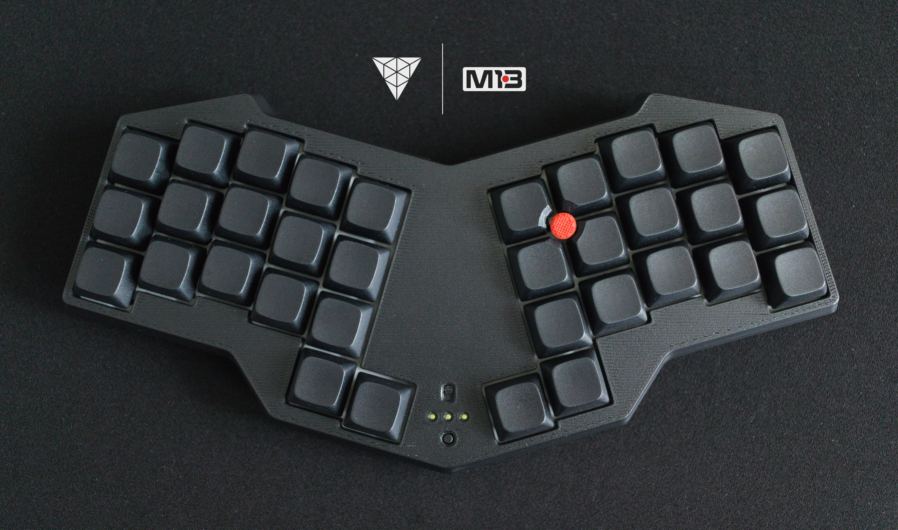
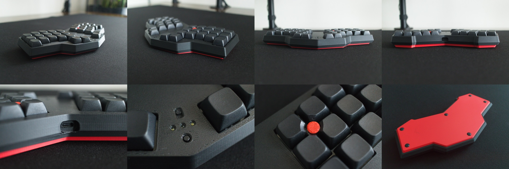

# M13 "Monolit"

M13 "Monolit" (Mono1337) is a wireless 34-key split keyboard with a unibody design and built-in TrackPoint support.

> [About](about.md) ● [Gallery](gallery.md) ● [TrackPoints](README.md#trackpoints) ● [Bill of Materials](README.md#bom) ●  [Build Guide](build.md) ● [ZMK Firmware](https://github.com/vrifmus/zmk-m13) ● [Lisence](README.md#license)

## Featers
* Wireless
* Status LEDs
* 34 Hotswap MX Keys
* TrackPoint mounting bracket
* Can be printed on 220x220mm build plate

# TrackPoints
## Modules
| Source | Left Side | Right Side | Stem Adaptor | Frame | Pinout |
| - | :-: | :-: | :-: | :-: | :-: |
| R61, X200/201 | ✅ | ✅ | ✅ | Built-in | [↗️](https://github.com/alonswartz/trackpoint/blob/master/pinouts/r61-2.jpg) |
| R40, T40 | ✅ | ✅ | 🚧 | 🚧 | [↗️](https://github.com/alonswartz/trackpoint/blob/master/pinouts/t40.png) |
| X60, T60, T400 | ⚠️ | ✅ | 🚧 | 🚧 | [↗️](https://github.com/alonswartz/trackpoint/blob/master/pinouts/28050.jpg)

<!-- ❓⛔️⚠️🚧 -->

## References
* https://github.com/joric/jorne/wiki/Tracking#trackpoints
* https://github.com/alonswartz/trackpoint
  * https://github.com/alonswartz/trackpoint/tree/master/pinouts
* https://github.com/infused-kim/kb_zmk_ps2_mouse_trackpoint_driver

## Caps
Due to the different heights of the keys, different 
cap adaptors are required. \
Different profile shapes require different drilling templates.

| Name      | Profile | Height | Template | Cap Adaptor |
| -         | -       | -      | :-: | :-: |
| DSA       | Uniform | 7.5mm  | ✅ | ✅ |
| NP        | Uniform | 8.8mm  | ✅ | ✅ |
| XDA       | Uniform | 9.1mm  | ✅ | ✅ |
| XDA V2    | Uniform | 9.5mm  | ✅ | ✅ |

# BOM
## Electronic components
| Item  | Quantity  | Description  |
| -     | -:        | -     |
| [MCU](https://aliexpress.com/item/1005006035267231.html?sku_id=12000035421753155)       | 1  | Supermini NRF52840 |
| [Switches](https://aliexpress.com/item/1005009233390385.html?sku_id=12000048413835668)         | 34 | MX |
| [Diodes](https://aliexpress.com/item/32968119428.html?sku_id=66573109482)                      | 34 | 1N4148 DO-35 150mA |
| [Slide Switch](https://aliexpress.com/item/1005008330569768.html?sku_id=12000044633870595)            | 1  | SS12D00 L2mm |
| [Reset](https://aliexpress.com/item/1005006046180384.html?sku_id=12000035472972538)            | 1  | 6x6x9mm |
| [LEDs](https://aliexpress.com/item/32791278183.html?sku_id=65455614167)                        | 3  | 1.8mm |
| [Resistors](https://aliexpress.com/item/1005005633571473.html?sku_id=12000033824013190)        | 3  | 1/8W 0.125W 1kΩ |
| [Wires](https://aliexpress.com/item/32947233235.html) [^1]                                        | 8 | UL1423 PTFE 30AWG |
| [Li Po Battery](https://aliexpress.com/item/1005002431038650.html?sku_id=12000049081233263)                             | 1  | 102040 |
| [Veroboard](https://aliexpress.com/item/1005010656258410.html?sku_id=12000053097924698)        | 1  | 2x8cm |
| [Capacitor](https://aliexpress.com/item/1005007160988407.html?sku_id=12000039654696628)        | 1  | 0603 SMD 2.2uF 25V X7R |
| [Resistor](https://aliexpress.com/item/1005009765892051.html?sku_id=12000050094928154)         | 2  | 0603 SMD 4.7K
| [Resistor](https://aliexpress.com/item/1005009765892051.html?sku_id=12000050094928186)         | 1  | 0603 SMD 100K
| [Brass Wire](https://aliexpress.com/item/1005003989879554.html?sku_id=12000027659173454) | 1 | H62 0.5mm |

## Mechanical parts

| Item  | Quantity  | Note  |
| -     | -:        | -     |
| [Keycaps](https://aliexpress.com/item/1005006910173774.html?sku_id=12000038697726410)          | 34 | XDA2 |
| [Screws](https://aliexpress.com/item/1005006738242477.html?sku_id=12000038138275695)           | 6  | M1.2x3mm |
| [Screws](https://aliexpress.com/item/1005004494509456.html?sku_id=12000029356038180)           | 6  | M2x3mm |
| [Screws](https://aliexpress.com/item/1005004494509456.html?sku_id=12000029356038182)          | 4 | M2x4mm |
| [Screws](https://aliexpress.com/item/1005004494509456.html?sku_id=12000029356038184) [^2]          | 2 | M2x5mm |
| [Screws](https://aliexpress.com/item/1005004494509456.html?sku_id=12000029356038192)           | 11 | M2x10mm |
| [Hex Nuts](https://aliexpress.com/item/1005007659048835.html?sku_id=12000041691145423) [^2] | 2 | M2 DIN439 
| [Heat Set Inserts](https://aliexpress.com/item/1005006198933795.html?sku_id=12000036235305382)      | 15 | M2 L2.5mm OD3.5 |
| [Bumpons](https://aliexpress.com/item/1005005467943079.html?sku_id=12000033199265741)          | 6  | 8x2mm |
| [Piercing Barbell](https://aliexpress.com/item/1005004855649051.html?sku_id=12000030762961405) | 1  | 14G 1.6x12mm (Internal Thread) |
| [TrackPoint Cap](https://aliexpress.com/item/1005008001443824.html?sku_id=12000043219016832)   | 1  | 9x5mm
| [Foam Tape](https://aliexpress.com/item/1005007679208422.html?sku_id=12000041882223615) | 1 | 20x2mm |
| Kapton/Insulate Tape | 1 |

## Tools
| Item  | Note  |
| -     | -     |
| [Nail Clipper](https://aliexpress.com/item/1005010392586783.html?sku_id=12000052258622407)     | Wire stripper tool base |
| Tweezers | |
| Soldering Iron |  |
| Soldering Iron tips for melting nuts |  |
| Soldering equipment | |
| Cutting knife | |
| Side Cutters | |
| Pliers | |
| Screwdrivers | Torx T5, Phillips PH000 |
| Drill/Electric Screwdriver | |
| [Drill Bit for Metal](https://aliexpress.com/item/1005005879852695.html?&sku_id=12000034681075974) | 10mm |
| [Countersink Drill](https://aliexpress.com/item/1005009396507996.html?sku_id=12000048975500571) [^3]| 16mm |
| Sandpaper | |

# License
 \
This work is licensed under a [Creative Commons Attribution-NonCommercial-ShareAlike 4.0 International License](https://creativecommons.org/licenses/by-nc-sa/4.0/).

[⬆️ Top](#m13-monolit)

[^1]: Color coding require 8 units: White, Grey, Black, Red, Green, Blue, Yellow, Orange.

[^2]: For TrackPoint modules without built-in frame and stock screws.

[^3]: I used this tool because it's inexpensive, but I think a higher-quality tool would have produced better results. If possible, you might want to try an [this one](https://aliexpress.com/item/1005004237838720.html?sku_id=12000028485015201).
