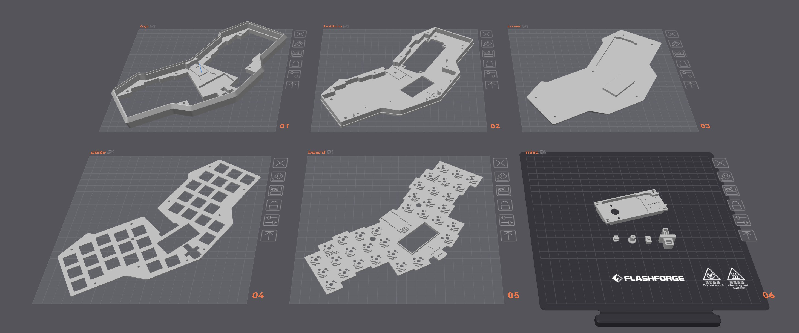
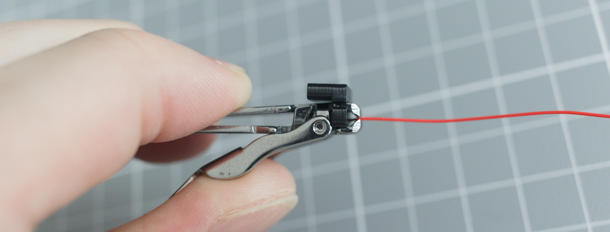
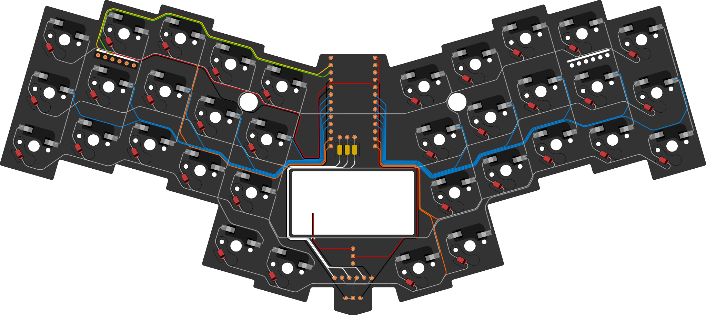
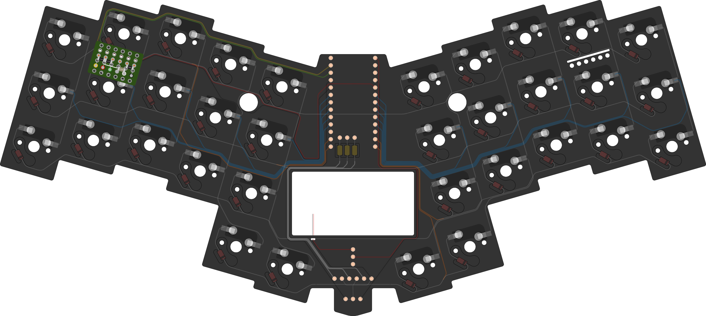
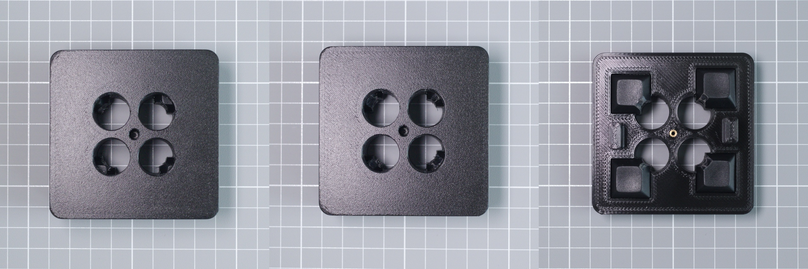
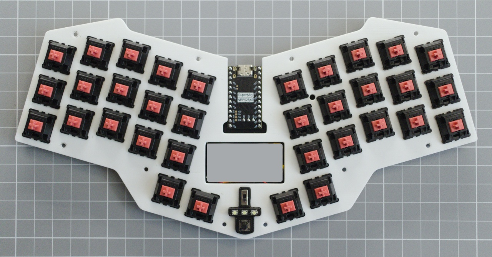
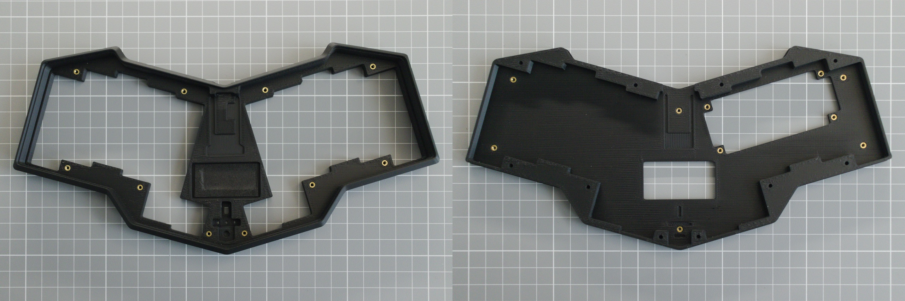
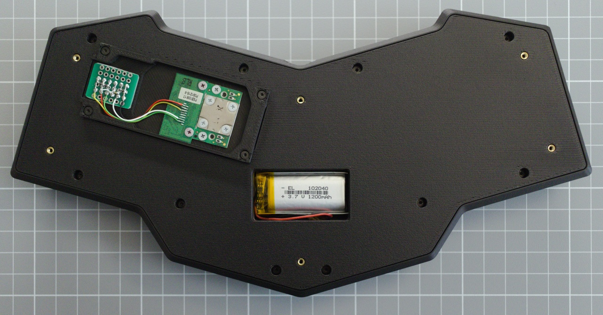
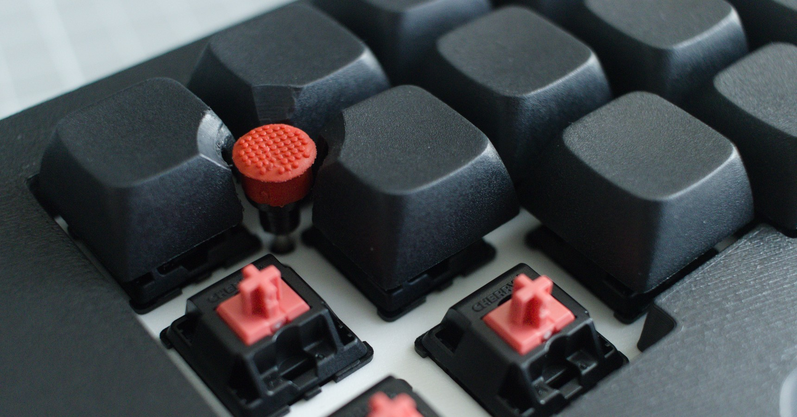

[⬅️ Home](README.md)

# Build guide
> ● [Printing](build.md#printing)
> ● [Wiring](build.md#wiring)
> ● [Main Circuit](build.md#main-circuit)
> ● [Reset Circuit](build.md#reset-circuit)
> ● [Keycaps](build.md#keycaps)
> ● [Assebmling](build.md#assembling)

# Printing

The keyboard parts are designed to be 3D printed on a 220x220mm build platform using a 0.4mm nozzle and a 0.2mm layer height.

## Orientation
The top part of the case is printed upside down, the bottom is in the normal position. \
The switch plate should be placed (rotated) face down.

## Settings
### Quality
* Seem
  * Seem position: Aligned back
* Wall generator: Arachne
* Walls and surfaces
  * Only one wall of first layer: True

### Support
* Support
  * Enable supports: True
  * Type: Tree (auto)
  * Style: Tree Strong
  * On build plate only: True
  * Ignore small overhangs: False
* Advanced
  * Interface pattern: Concentric
  * Support/object XY distance: 0.4
  * Support/object first layer gap: 0.4

# Wiring
Wires have a thin PTFE insulation, what hard to remove. For stripping need to make a tool from nail knipser and 3d printed spacer.

## Stripping

Place the spacer on the knipser and cut the insulation by 2-3 mm. Short wires should be held with tweezers.

> [!TIP]
> Pinch the wire at the beginning and wrap the end around the tweezers.

## Soldering
Solder wire connections with a 2-3mm overlap. To solder wires to the socket legs, bend the exposed end 90 degrees.

# Main Circuit
Click on image for details.

# Reset Circuit
Click on image for details.

# Keycaps

To cut out the keycaps for the TrackPoint, need to make a drilling template.\
Print out the parts, melt the nut into the base.

## Drilling
* Insert the keycaps into the base, install the cover and secure it with the M2 screw.
* Insert the drilling stencil into the cover.
* Using an 10mm drill bit, on maximum RPM start drilling counterclockwise, with applying some force.
> [!IMPORTANT]
> Counterclockwise direction is important, otherwise you can break off a piece from a keycap.
* Once the drill has gone all the way through, you can move clockwise.

## Сountersinking
* Remove the drilling stencil.
* Using a countersink bit, begin drilling clockwise on maximum RPM with applying light force, checking the depth and shape periodically. The edge should reach the edge of the hole.

## Finishing
Remove the keycaps, remove the plastic shavings, you can use a cutting knife and sandpaper.

# Assembling

## MCU
Place the bord into the bottom case.

* Place MCU on the sockets.
* Make pins from the brass wire, solder.

## Power and LEDs
* Install the mounting frame onto the sockets.
* Shorten the LED legs to a length of 10mm and insert them into the sockets through the frame, observing the polarity.
  * (-)  [ O ) [ O ) [ O ) (+)
* Insert reset button and power switch.

## Switches and Plate
* Insert several switches into the plate at the corners and in the center.
* Connect the plate and the circuit board. Place rest ot the switches.

## Case

* Heat and insert nuts.
* Cut two pieces of foam tape, each 40mm long.
  * Glue one to the battery location on the top of the case and the other to the cover stand.
* Insert board into the bottom case.
  * Put the power slider on the power switch.
  * Place the top case.
* Carefully holding the center section, turn the resulting structure over and tighten it with M2x10mm screws.

## TrackPoint

* Using 4 M1.2x3mm screws tighten the reset circuit to the bracket.
* Screw the module to the bracket. 
  * Using wires connect reset circuit to the module's pinout.
    

    * Yellow - SCK / CLK
    * Red - VCC
    * Green - SDA / DATA
    * Grey - not used
    * Reset - RST
    * Black - GND
* Insert barbell to the stem. Holding barbell with pliers tighten the M1.2x3mm screw.
* Place the ressulting rod onto the module.
> [!TIP]
> To ensure tight contact and prevent play, place a piece of thin, stretchable film, approximately 15x15 mm in size, such as packaging film, between the module rod and the extension.

* Insert the bracket into the socket.
* Using M2x4mm screws tighten the bracket to the bottom case.

## Finishing

* Connect the battery and install it into the compartment.
* Tighten cover-stand with M2x3mm screws.
  * Place the bumpons.
* Insert trackpoint cap adapter on the rod.
  * Tighten with the m1.2x3mm screw.
  * Install the TrackPoint cap.
* Install keycaps.

# Done
You are great!

[⬅️ Home](README.md)