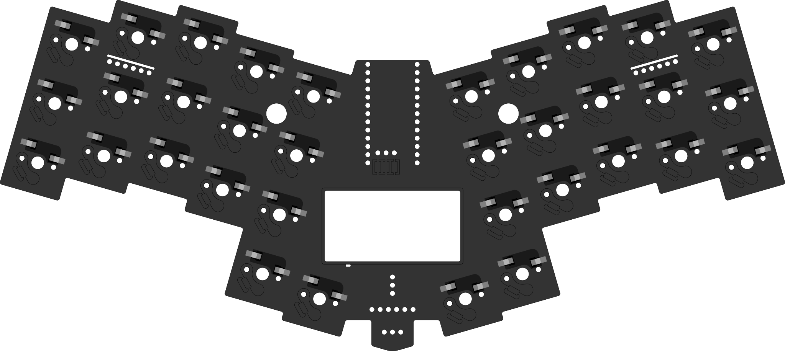
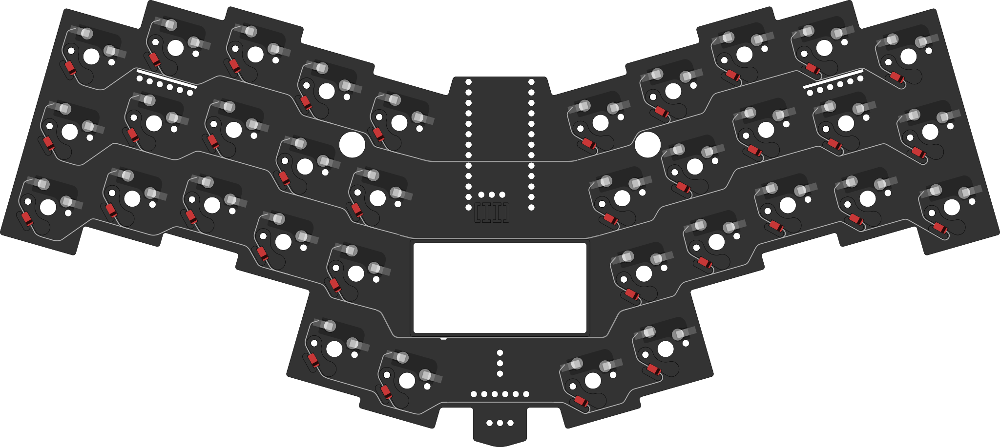
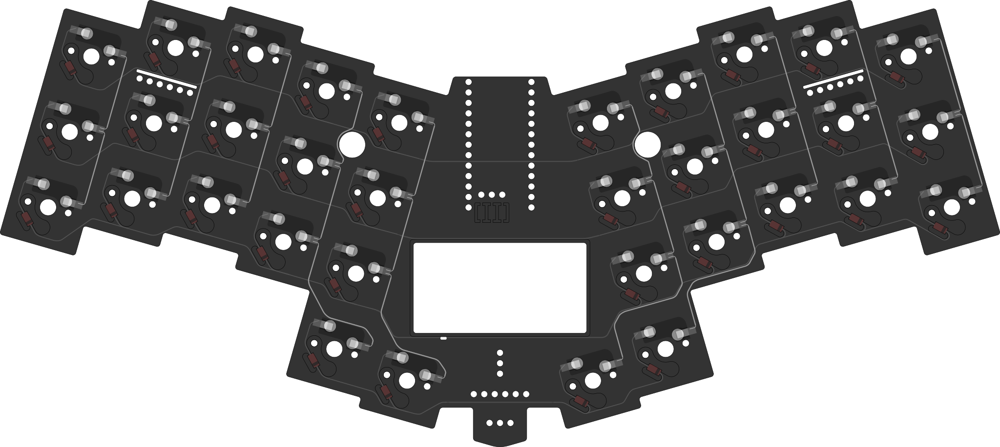
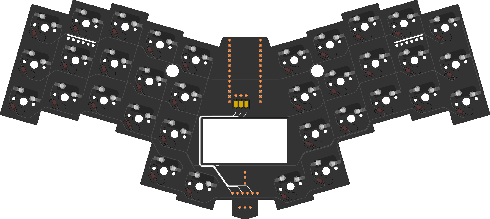
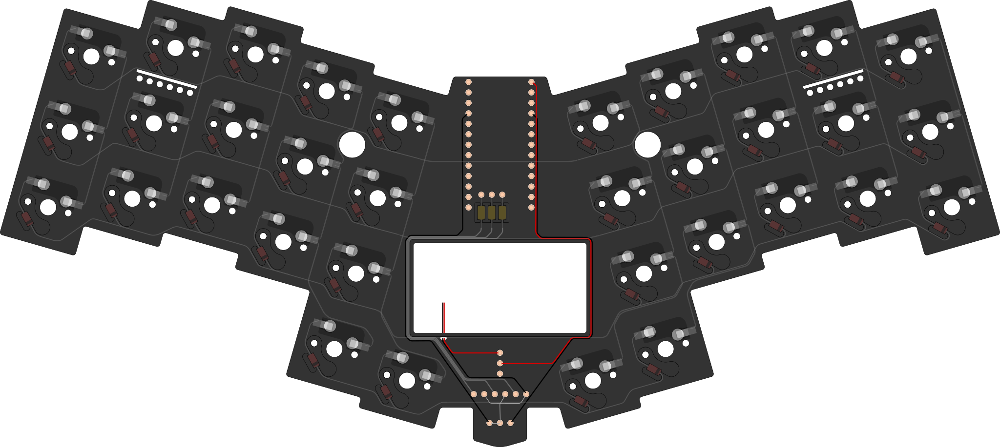
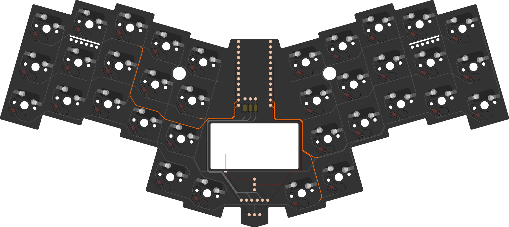
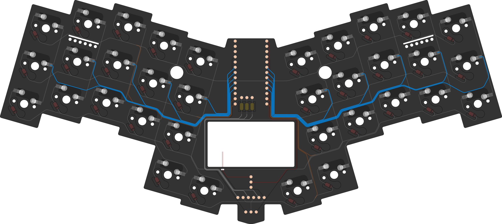
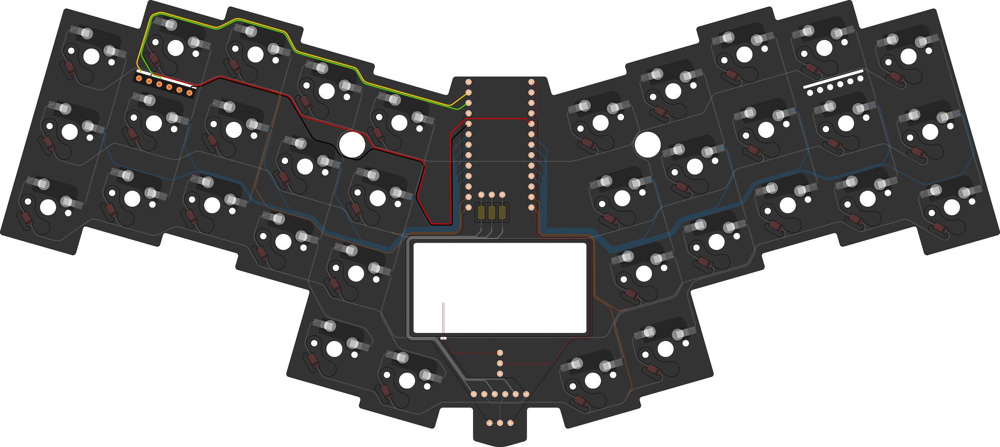

[⬅️ Build guide](build.md#main-circuit)

# Making Circuit Board

## Color coding
* Balck - Ground
* Red - Power
* Grey - Matrix
* White - LEDs
* Orange - Rows
* Blue - Cols
* Yellow - Clock
* Green - Data

## HotSwap Sockets
Push sockets into the holes using something flat on the hard surface.

## Rows
Place diodes into the holders, form legs into the rows. Solder. \
Using piece of wires connect two halfs of rows.

## Collumns
Using piece of wires make collumns.

## LEDs
Mount machine pin sockets. \
Place resistors into the holders. \
Using wires, connect resistors to the LEDs socket pins.

## Power Circuit
Using wires, build the circuit for the power routes. \
Using diode legs make ground node, connect LEDs cathodes to the ground pin of the reset button.

## Routing Rows
Using wires, connect the rows to the controller socket pins.

## Routing Columns
Using wires, connect the columns to the controller socket pins.

> [!TIP]
> Start wiring from the bottom contacts.

## Trackpoint Connector
Mount machine pin coskets.
Using wires connect trackpoint socket to controller socket pins.

> [!NOTE]
> Pinout: YRG--B

## Final look

[⬅️ Build guide](build.md#main-circuit)
