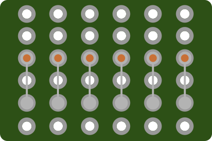
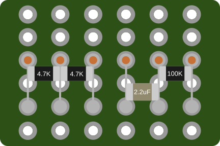
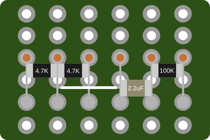
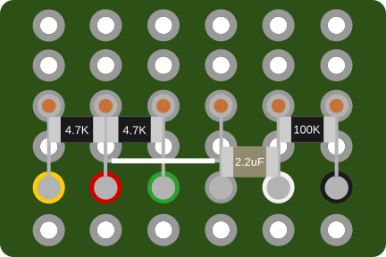

[⬅️ Build guide](build.md#reset-circuit)

# Making Reset Circuit Board

## Board
Make a 6x6 breadboard. Use a cutting knife to make cuts on both sides of the board, then snap it off along the cuts.

## Routes
Insert the pins into the sockets and solder the board.
Using legs from the diodes, make columns from R3 to R5.

## Components
Place and solder components.

## Wireing
Using wire connect R2 to R4.

## Pinout

[⬅️ Build guide](build.md#reset-circuit)